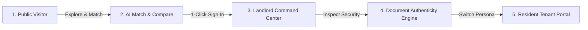

# Nestara AI — Digital Property Rental & Intelligence System

> **Find Better. Match Smarter. Manage Seamlessly.**

Nestara AI is an enterprise-grade digital property operating system that bridges the gap between property managers, current residents, and prospective home seekers. Built on modern edge-first architecture, it unifies public residential discovery, mathematical AI lifestyle recommendations, tenant self-service, cryptographic document authenticity verification, and back-office portfolio operations under a single, cohesive, self-hostable platform.

---

## 🧭 Live Demo & Client Presentation Workflow

For client demos and screen-sharing sessions, the system offers an automated persona-based workflow:



### 1. Public Visitor Journey (`/explore`)
- **Distraction-Free Discovery:** Public visitors see a full-width experience without internal management sidebars.
- **Curated Bengaluru Residences:** Direct owner listings across Koramangala, Indiranagar, HSR Layout, Lavelle Road, and Whitefield with 0% brokerage.
- **AI Recommendation Engine:** Multidimensional vector similarity matching evaluating budget, layout density, and commute hubs (e.g. RMZ Ecospace, Manyata Tech Park).
- **Side-by-Side Comparison Matrix:** Pin up to 3 candidate residences in a floating comparison dock and analyze price-per-square-foot efficiency, layout density, and amenities side-by-side.

### 2. Landlord & Manager Operations (`/dashboard`)
- **Executive Real-Time KPIs:** Dynamic SVG **Occupancy Gauge** ring and a proportional **Monthly Cashflow Realization Bar** (collected vs. pending vs. overdue).
- **Zero-Trust Tenant Directory (`/tenants`):** Tenant phone numbers, emails, and stated incomes are masked by default (`jo****@gmail.com`, `+91 98****3210`). Clicking the reveal eye icon logs an immutable entry to `audit_logs` for DPDP and GDPR compliance.
- **Lease & Unit Management:** 1-click renewal triggers, pro-rated rent calculations, and automated status synchronization.

### 3. Edge Cryptographic Document Authenticity Engine (`/documents`)
- **Forensic Tamper Detection:** Evaluates uploaded tenant payslips, ID cards (Aadhaar / PAN), and employment letters.
- **Mathematical Integrity Validation:** Inspects basic salary, HRA, and deductions logic to detect fabricated or edited figures.
- **Distributed Hash Ledger:** Each verified document generates a unique SHA-256 fingerprint anchored to a cryptographic Merkle block hash chain.

### 4. Resident Self-Service Portal (`/portal`)
- **Lease Overview & Rent Receipts:** View active lease details and generate audit-grade bilingual residential agreements and payment receipts with one click.
- **AI Maintenance Triage:** Residents log repair requests; the AI engine automatically classifies trade category, estimates costs in INR, and assigns urgency ratings (`urgent`, `high`, `normal`, `low`).

---

## 🔑 1-Click Demo Credentials (Instant Sign-In)

The login modal includes **1-Click Auto Sign-In buttons** for instant, frictionless transitions during live demos:

| Persona | Email | Password | Access Level & Key Demo Features |
|---|---|---|---|
| **Public Visitor** | *(No Login)* | — | Full-width public listings, lifestyle filters, side-by-side comparison dock. |
| **Landlord / Manager** | `demo@nestara.ai` | `Password123!` | Executive dashboard, tenant directory with PII unmasking, rent ledger, lease renewal. |
| **Resident Tenant** | `tenant1@nestara.ai` | `Password123!` | Active lease status, rent payment history, PDF receipts, AI maintenance triage. |
| **Platform Admin** | `admin@nestara.ai` | `Admin123!` | Complete administrative authority, audit log inspection, distributed ledger blocks. |

---

## 🛡️ Zero-Trust Security & Enterprise Architecture

| Security & Compliance Domain | Implementation Details |
|---|---|
| **DPDP & GDPR Personal Data Privacy** | Sensitive tenant PII (emails, phone numbers, stated monthly income) is masked by default on both frontend and backend. Unmasking events trigger an automatic immutable audit trail capturing actor, target, timestamp, and IP address. |
| **Brute-Force & Rate Limiting Defense** | 5 consecutive failed login attempts trigger an automatic 15-minute account lockout (HTTP 429) with `Retry-After: 900`. Rate limiters protect public leasing application submissions. |
| **Cryptographic Authentication** | Passwords salted and hashed via hardware-accelerated **PBKDF2-HMAC-SHA256** (100,000 iterations) using native Web Crypto APIs with constant-time equality checks. |
| **Stateless Token Versioning** | Database-backed `token_version` tracking guarantees instant session revocation across all devices upon logout. |
| **Dual-Mode Database Adapter** | Seamlessly connects to **PostgreSQL (Supabase / Neon)** with kernel-enforced Row-Level Security (RLS) when `DATABASE_URL` is set, with automatic fallback to **Cloudflare D1 / SQLite** for edge zero-config deployments. |
| **Security Headers & Cookie Defense** | Hardened with HSTS, `X-Frame-Options: DENY`, `X-Content-Type-Options: nosniff`, `Cross-Origin-Resource-Policy: same-origin`, and `HttpOnly; SameSite=Lax` cookie transport. |

---

## 💻 Technology Stack

| Layer | Technology | Purpose |
|---|---|---|
| **Frontend Framework** | [React 18](https://react.dev/) & [TypeScript](https://www.typescriptlang.org/) | Type-safe, component-driven reactive user interface |
| **UI Aesthetics** | Clean Nordic Minimalist Tokens | Obsidian ink typography, zinc slates, hairline micro-borders, and high-contrast tables |
| **Build & Tooling** | [Vite 6](https://vitejs.dev/) | Sub-second HMR, tree-shaking, and optimized production chunking |
| **Component Primitives** | [Radix UI](https://www.radix-ui.com/) & [Tailwind CSS v4](https://tailwindcss.com/) | Accessible, responsive, mobile-first design system |
| **Icons** | [Lucide React](https://lucide.dev/) | Clean, consistent SVG icon system |
| **Edge API Framework** | [Hono v4](https://hono.dev/) | Ultrafast, lightweight edge web standard router (<15KB) |
| **Database Engine** | [Cloudflare D1](https://developers.cloudflare.com/d1/) / [PostgreSQL](https://www.postgresql.org/) | Dual-mode relational database with ACID compliance and RLS |
| **Document Forensics** | Web Crypto SHA-256 Engine | Client & edge cryptographic fingerprinting and Merkle audit blocks |
| **Test Suite** | [Vitest](https://vitest.dev/) | Automated unit, security, and document verification tests |

---

## 🚀 Quickstart & Local Setup

### Prerequisites
- **Node.js:** `>= 20.0.0` (Tested on Node `v24.19.0`)
- **Package Manager:** `npm` (bundled with Node.js) or `pnpm` (`>= 9.0.0`)

### 1. Clone & Install Dependencies
```bash
git clone https://github.com/rootnode-rebels/nestara-ai.git
cd nestara-ai
npm install   # or: pnpm install
```

### 2. Initialize the Database
Initialize the relational schema and seed default demo properties, units, and verified accounts:
```bash
npm run db:migrate   # or: pnpm db:migrate
```

### 3. Start the Development Server
```bash
npm run dev   # or: pnpm dev
```
The application will boot concurrently:
- **Frontend Web UI:** [http://localhost:5173](http://localhost:5173)
- **Backend API:** [http://localhost:8787](http://localhost:8787)
- **Health Check:** [http://localhost:8787/api/health](http://localhost:8787/api/health)

### 4. Verification & Testing
```bash
npm test         # Runs all 43 automated tests (Vitest)
npm run typecheck # Validates TypeScript compilation with 0 errors
```

---

## 📂 Repository Structure

```
nestara-ai/
├── docs/
│   ├── DATABASE_ARCHITECTURE.md        # Technical blueprint for PostgreSQL RLS & DPDP
│   ├── PHASED_SYSTEM_IMPROVEMENTS.md   # Phased production improvement roadmap
│   └── ARCHITECTURE.md                 # System overview and edge design patterns
├── src/
│   ├── client/
│   │   ├── components/
│   │   │   ├── public/                 # Visitor explore, AI matchmaker, property compare
│   │   │   ├── dashboard/              # Occupancy gauge & realization analytics
│   │   │   ├── documents/              # Cryptographic document authenticity ledger
│   │   │   ├── tenant/                 # Resident self-service portal
│   │   │   ├── tenants/                # Tenant directory with PII privacy masking
│   │   │   ├── leases/                 # Residential agreements & renewal actions
│   │   │   ├── rent/                   # Rent ledger & payment dialogs
│   │   │   └── ui/                     # Nordic UI buttons, dialogs, toasts
│   │   ├── lib/
│   │   │   ├── privacy.ts              # PII masking utilities (email, phone, income)
│   │   │   └── document-generator.ts   # Bilingual tenancy agreement & PDF receipt generator
│   ├── server/
│   │   ├── document-authenticator.ts   # SHA-256 fingerprinting & Merkle hash chain ledger
│   │   ├── auth.ts                     # PBKDF2 password hashing & token versioning
│   │   ├── db.ts                       # Dual-mode SQLite/D1 and PostgreSQL adapter
│   │   ├── schema.sql                  # Edge relational schema DDL with demo accounts
│   │   └── supabase-schema.sql         # Enterprise PostgreSQL schema with Row-Level Security
└── package.json
```
