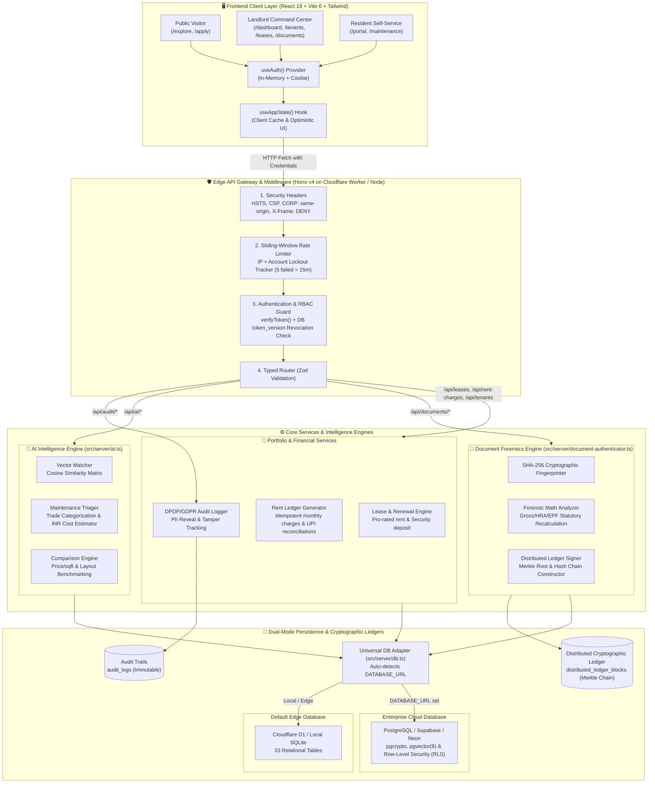

# Nestara AI — Digital Property Rental & Intelligence System

> **Find Better. Match Smarter. Manage Seamlessly.**

Nestara AI is an enterprise-grade digital property operating system that bridges the gap between property managers, current residents, and prospective home seekers. Built on modern edge-first architecture, it unifies public residential discovery, mathematical AI lifestyle recommendations, tenant self-service, cryptographic document authenticity verification, and back-office portfolio operations under a single, cohesive, self-hostable platform.

---

## 🏗️ End-to-End System Architecture & Data Flow

Below is the comprehensive technical diagram illustrating how data flows from user interfaces, through the edge middleware pipeline, into analytical engines, and out to persistent storage adapters.



---

## 🔄 Detailed Operational Workflows

### Workflow 1: Public Exploration & AI Matching Flow
1. **User Request:** User visits `/explore`, types search criteria (`Indiranagar`, `3 BHK`, `< ₹70,000`), or opens **AI Matchmaker**.
2. **Client Call:** [`ExplorePage`](file:///d:/projects/nestaraai/Nestara-AI-main/src/client/components/public/explore-page.tsx) dispatches `GET /api/public/listings?search=...`.
3. **Gateway Handling:** Passed through CORS and edge cache without authentication requirement.
4. **AI Vector Ranking:** [`ai.ts`](file:///d:/projects/nestaraai/Nestara-AI-main/src/server/ai.ts) computes weighted vector distance comparing unit budget, BHK ratio, and commute target (e.g. RMZ Ecospace) returning a calculated score (`98% Match`).
5. **Comparison Matrix:** If the visitor selects 2-3 listings and clicks **Compare Side-by-Side**, `POST /api/ai/compare` runs a multi-criteria attribute benchmark (price per sq.ft, amenity scores, layout efficiency).

---

### Workflow 2: Zero-Trust Security & PII Privacy Flow
1. **Data Masking on Fetch:** When a manager navigates to `/tenants` or `/applications`, the client receives records but renders them through [`maskEmail()`](file:///d:/projects/nestaraai/Nestara-AI-main/src/client/lib/privacy.ts) and [`maskPhone()`](file:///d:/projects/nestaraai/Nestara-AI-main/src/client/lib/privacy.ts) (`jo****@gmail.com`, `+91 98****3210`).
2. **PII Reveal Trigger:** The manager clicks the **Eye Icon** to view the full phone number or income.
3. **Audit Dispatch:** The frontend immediately fires `POST /api/audit/log` with:
   - `action`: `"reveal_pii"`
   - `target_type`: `"tenant"`
   - `target_id`: Tenant ID
   - `details`: `"Viewed unmasked phone & income"`
4. **Backend Ingestion:** Hono extracts the manager's authenticated JWT identity, captures the client IP address, and inserts an immutable audit log record.
5. **PostgreSQL RLS Enforcement:** In enterprise PostgreSQL deployments, database kernel Row-Level Security policies ensure tenant rows cannot be queried outside the landlord's explicit organization boundary.

---

### Workflow 3: Edge Cryptographic Document Forensics Flow
1. **Document Upload:** An applicant or tenant uploads an identity card or payslip PDF (`/documents`).
2. **SHA-256 Fingerprint Derivation:** [`document-authenticator.ts`](file:///d:/projects/nestaraai/Nestara-AI-main/src/server/document-authenticator.ts) computes the raw binary SHA-256 digest (`file_hash_sha256`).
3. **Forensic Algorithmic Checks:**
   - **Payslip Math Check:** Validates if `Basic + HRA + Allowances - Deductions = Net Pay`. Flags mathematical discrepancies.
   - **EPF Statutory Cap Check:** Verifies statutory Indian employee provident fund caps (₹1,800 threshold).
   - **Metadata & PDF Producer Inspection:** Inspects PDF binary header tags for graphic editing tools (Photoshop, Canva, Acrobat Modified).
4. **Merkle Block Construction:** The verification record, timestamp, authenticity score, and previous block hash are chained into `distributed_ledger_blocks`.
5. **Instant Tamper Verification:** Any subsequent verification compares current hash against the ledger to prove the document has not been altered post-signature.

---

### Workflow 4: Tenant Self-Service & Maintenance AI Triage Flow
1. **Tenant Ticket Submission:** Resident logs into `/portal` and reports an issue (*"Kitchen pipe leaking under sink, water pooling"*).
2. **AI Triage Processing:** `POST /api/ai/triage-maintenance` is triggered:
   - NLP parser extracts keywords: `leaking`, `pipe`, `water`.
   - Assigns category: `"plumbing"`.
   - Computes urgency: `"high"` (due to water damage risk).
   - Projects estimated repair cost: `₹1,200 - ₹2,500 INR`.
3. **Database Insertion:** A work order row is inserted linked to the tenant's `unit_id` and assigned to local plumbing vendors from the `vendors` directory.
4. **Receipt Generation:** Tenant clicks **"Print Rent Receipt"** → [`document-generator.ts`](file:///d:/projects/nestaraai/Nestara-AI-main/src/client/lib/document-generator.ts) compiles legal English/Kannada tenancy terms into a printable print window directly in the browser without server roundtrip latency.

---

## 🔑 1-Click Demo Credentials (Instant Sign-In)

The login modal includes **1-Click Auto Sign-In buttons** for instant, frictionless transitions during live demos:

| Persona | Email | Password | Access Level & Key Demo Features |
|---|---|---|---|
| **Public Visitor** | *(No Login)* | — | Full-width public listings, lifestyle filters, side-by-side comparison dock. |
| **Landlord / Manager** | `demo@nestara.ai` | `Password123!` | Executive dashboard, tenant directory with PII unmasking, rent ledger, lease renewal. |
| **Resident Tenant** | `tenant1@nestara.ai` | `Password123!` | Active lease status, rent payment history, PDF receipts, AI maintenance triage. |
| **Platform Admin** | `admin@nestara.ai` | `Admin123!` | Complete administrative authority, audit log inspection, distributed ledger blocks. |

---

## 🛡️ Zero-Trust Security & Enterprise Specifications

| Security & Compliance Domain | Implementation Details |
|---|---|
| **DPDP & GDPR Personal Data Privacy** | Sensitive tenant PII (emails, phone numbers, stated monthly income) is masked by default on both frontend and backend. Unmasking events trigger an automatic immutable audit trail capturing actor, target, timestamp, and IP address. |
| **Brute-Force & Rate Limiting Defense** | 5 consecutive failed login attempts trigger an automatic 15-minute account lockout (HTTP 429) with `Retry-After: 900`. Rate limiters protect public leasing application submissions. |
| **Cryptographic Authentication** | Passwords salted and hashed via hardware-accelerated **PBKDF2-HMAC-SHA256** (100,000 iterations) using native Web Crypto APIs with constant-time equality checks. |
| **Stateless Token Versioning** | Database-backed `token_version` tracking guarantees instant session revocation across all devices upon logout. |
| **Dual-Mode Database Adapter** | Seamlessly connects to **PostgreSQL (Supabase / Neon)** with kernel-enforced Row-Level Security (RLS) when `DATABASE_URL` is set, with automatic fallback to **Cloudflare D1 / SQLite** for edge zero-config deployments. |
| **Security Headers & Cookie Defense** | Hardened with HSTS, `X-Frame-Options: DENY`, `X-Content-Type-Options: nosniff`, `Cross-Origin-Resource-Policy: same-origin`, and `HttpOnly; SameSite=Lax` cookie transport. |

---

## 💻 Technology Stack

| Layer | Technology | Purpose |
|---|---|---|
| **Frontend Framework** | [React 18](https://react.dev/) & [TypeScript](https://www.typescriptlang.org/) | Type-safe, component-driven reactive user interface |
| **UI Aesthetics** | Clean Nordic Minimalist Tokens | Obsidian ink typography, zinc slates, hairline micro-borders, and high-contrast tables |
| **Build & Tooling** | [Vite 6](https://vitejs.dev/) | Sub-second HMR, tree-shaking, and optimized production chunking |
| **Component Primitives** | [Radix UI](https://www.radix-ui.com/) & [Tailwind CSS v4](https://tailwindcss.com/) | Accessible, responsive, mobile-first design system |
| **Icons** | [Lucide React](https://lucide.dev/) | Clean, consistent SVG icon system |
| **Edge API Framework** | [Hono v4](https://hono.dev/) | Ultrafast, lightweight edge web standard router (<15KB) |
| **Database Engine** | [Cloudflare D1](https://developers.cloudflare.com/d1/) / [PostgreSQL](https://www.postgresql.org/) | Dual-mode relational database with ACID compliance and RLS |
| **Document Forensics** | Web Crypto SHA-256 Engine | Client & edge cryptographic fingerprinting and Merkle audit blocks |
| **Test Suite** | [Vitest](https://vitest.dev/) | Automated unit, security, and document verification tests |

---

## 🚀 Quickstart & Local Setup

### Prerequisites
- **Node.js:** `>= 20.0.0` (Tested on Node `v24.19.0`)
- **Package Manager:** `npm` (bundled with Node.js) or `pnpm` (`>= 9.0.0`)

### 1. Clone & Install Dependencies
```bash
git clone https://github.com/rootnode-rebels/nestara-ai.git
cd nestara-ai
npm install   # or: pnpm install
```

### 2. Initialize the Database
Initialize the relational schema and seed default demo properties, units, and verified accounts:
```bash
npm run db:migrate   # or: pnpm db:migrate
```

### 3. Start the Development Server
```bash
npm run dev   # or: pnpm dev
```
The application will boot concurrently:
- **Frontend Web UI:** [http://localhost:5173](http://localhost:5173)
- **Backend API:** [http://localhost:8787](http://localhost:8787)
- **Health Check:** [http://localhost:8787/api/health](http://localhost:8787/api/health)

### 4. Verification & Testing
```bash
npm test         # Runs all 43 automated tests (Vitest)
npm run typecheck # Validates TypeScript compilation with 0 errors
```

---

## 📂 Repository Structure

```
nestara-ai/
├── docs/
│   ├── DATABASE_ARCHITECTURE.md        # Technical blueprint for PostgreSQL RLS & DPDP
│   ├── PHASED_SYSTEM_IMPROVEMENTS.md   # Phased production improvement roadmap
│   └── ARCHITECTURE.md                 # System overview and edge design patterns
├── src/
│   ├── client/
│   │   ├── components/
│   │   │   ├── public/                 # Visitor explore, AI matchmaker, property compare
│   │   │   ├── dashboard/              # Occupancy gauge & realization analytics
│   │   │   ├── documents/              # Cryptographic document authenticity ledger
│   │   │   ├── tenant/                 # Resident self-service portal
│   │   │   ├── tenants/                # Tenant directory with PII privacy masking
│   │   │   ├── leases/                 # Residential agreements & renewal actions
│   │   │   ├── rent/                   # Rent ledger & payment dialogs
│   │   │   └── ui/                     # Nordic UI buttons, dialogs, toasts
│   │   ├── lib/
│   │   │   ├── privacy.ts              # PII masking utilities (email, phone, income)
│   │   │   └── document-generator.ts   # Bilingual tenancy agreement & PDF receipt generator
│   ├── server/
│   │   ├── document-authenticator.ts   # SHA-256 fingerprinting & Merkle hash chain ledger
│   │   ├── auth.ts                     # PBKDF2 password hashing & token versioning
│   │   ├── db.ts                       # Dual-mode SQLite/D1 and PostgreSQL adapter
│   │   ├── schema.sql                  # Edge relational schema DDL with demo accounts
│   │   └── supabase-schema.sql         # Enterprise PostgreSQL schema with Row-Level Security
└── package.json
```
