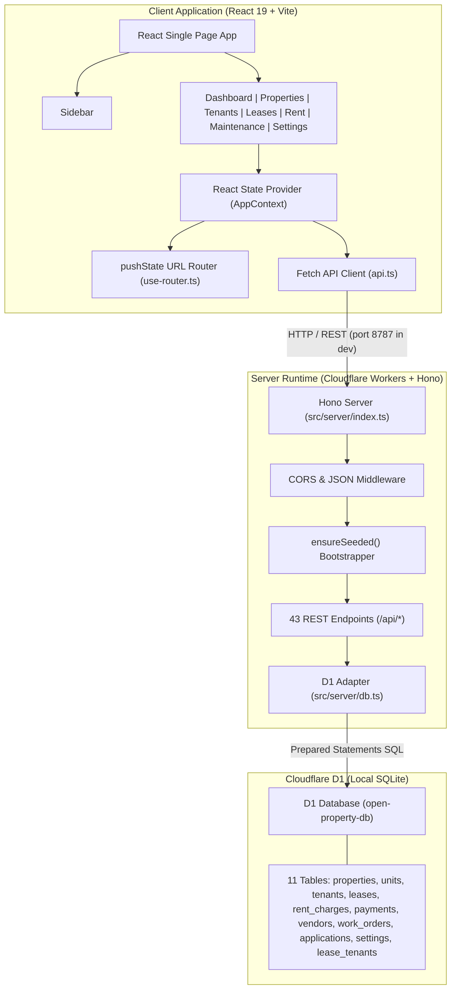
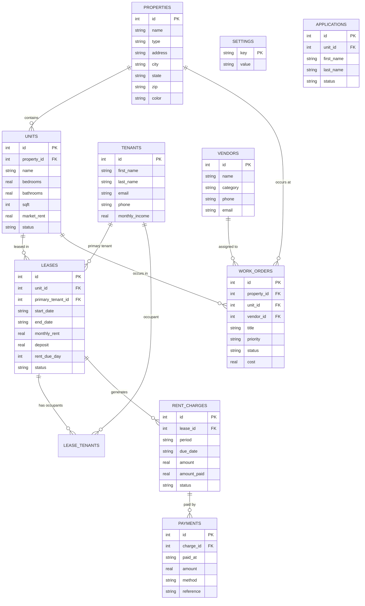
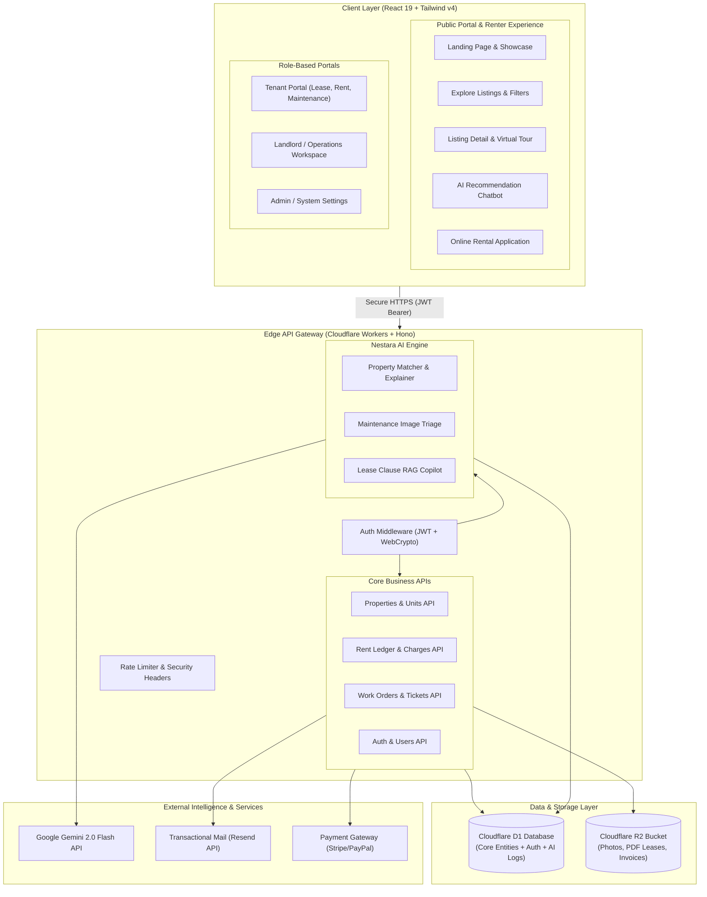
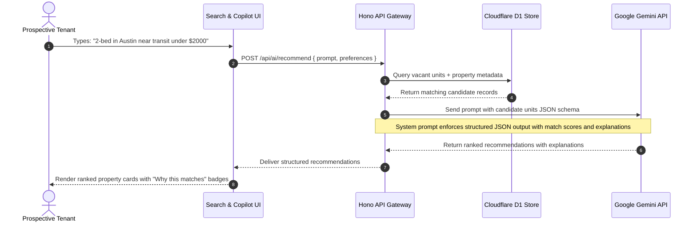
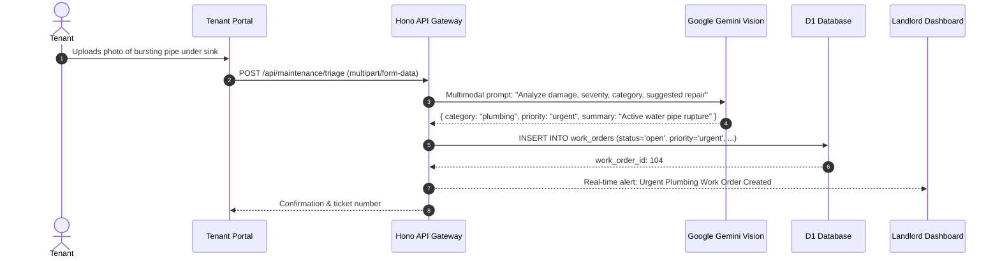

# System Architecture — Nestara AI

**Date:** October 22, 2026  
**Auditor / Architect:** Senior Software Architect  
**Scope:** Current As-Audited Architecture and Target Production Architecture for Nestara AI.

---

## 1. Architectural Philosophy & Strategy

Nestara AI builds upon the rock-solid foundation of **OpenProperty**:
1. **Edge-First Serverless Backend:** Cloudflare Workers running Hono delivers sub-50ms cold starts globally with zero DevOps maintenance.
2. **Embedded Relational Store:** Cloudflare D1 provides full relational ACID guarantees and standard SQLite syntax without managing a dedicated database cluster.
3. **Modern Unified Frontend:** React 19 with Vite and Tailwind CSS v4 delivers rapid iteration, type safety, and responsive design across desktop and mobile.
4. **Intelligent Edge AI:** Rather than maintaining cumbersome Python microservices with heavy PyTorch/CUDA containers, Nestara AI integrates AI capabilities via direct, streaming API calls to Google Gemini models from Cloudflare Workers.

---

## 2. Current Architecture (As-Audited Baseline)

The current baseline is completely functional for a single back-office landlord user.

### 2.1 Current Architecture Diagram

### 2.2 Current Entity-Relationship (ER) Diagram

### 2.3 Limitations of Current Baseline
1. **No Authentication or Access Control:** Any client with HTTP access can query or mutate all endpoints.
2. **Single Audience (Landlord Back-Office Only):** Prospective renters cannot browse listings; current tenants cannot view their ledger or submit repair requests online.
3. **No AI Capabilities:** No conversational assistance, no recommendation engine, no image triage.
4. **No Public Storage for Media:** Properties and work orders cannot store or display photographic attachments.

---

## 3. Target Production Architecture (Nestara AI)

The planned architecture extends the core into a dual-portal platform (Public Tenant Portal + Landlord Management Workspace) with an intelligent AI copilot layer.

### 3.1 Target Architecture Diagram

### 3.2 AI Recommendation & Search Data Flow

### 3.3 Maintenance Image Triage Data Flow

---

## 4. Integration Boundaries & Isolation Directives

To maintain complete stability and clean architectural boundaries:
1. **Primary App Isolation:** `OpenProperty/` is the sole production runtime and Git repository. No code from external reference repositories may be imported directly via `package.json` references.
2. **Schema Migration Discipline:** All future D1 schema modifications must append backwards-compatible DDL migrations in `src/server/schema.sql`.
3. **Authentication Boundary:** Public endpoints (`/api/public/*`, `/api/auth/*`) will be separated from protected manager endpoints (`/api/admin/*`, `/api/properties/*`) using explicit Hono route groups (`const privateApi = new Hono()`).
4. **AI Graceful Degradation:** All AI endpoints must catch external LLM timeout or quota errors and fall back gracefully to deterministic database search and default normal ticket prioritization.
