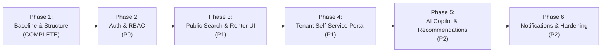

# Implementation Roadmap — Nestara AI

**Date:** October 22, 2026  
**Auditor / Lead Engineer:** Senior Software Architect  
**Objective:** A phased, dependency-aware engineering roadmap to evolve the validated OpenProperty baseline into the full Nestara AI production platform.

---

## Roadmap Phases Overview

---

## Phase 1: Stable Baseline & Workspace Organization (Status: COMPLETE)

| Task ID | Task | Priority | Dependencies | Files Affected | Acceptance Criteria | Tests Required | Status |
| :--- | :--- | :--- | :--- | :--- | :--- | :--- | :--- |
| **T1.1** | Audit all repositories and verify Git history & licenses | P0 | None | Workspace sibling directories | All repositories categorized; empty clone identified; remotes recorded | Directory inspection, git status checks | **COMPLETE** |
| **T1.2** | Organize sibling reference repositories outside product core | P0 | T1.1 | Top-level workspace | Reference repos maintained as siblings outside `OpenProperty` preserving `.git` | Directory tree inspection | **COMPLETE** |
| **T1.3** | Validate baseline builds, typechecks, and D1 migrations | P0 | T1.1 | `OpenProperty/` | `tsc --noEmit` exits 0; `vite build` succeeds; D1 schema migrates | `pnpm typecheck`, `pnpm build`, `pnpm db:migrate` | **COMPLETE** |
| **T1.4** | Clean upstream branding & obsolete manifest references | P1 | T1.3 | `app.tsx`, `index.html`, `manifest.json`, `clawnify.json` | Brand displays "Nestara AI"; stale `sidebar.tsx` removed; clean re-build | `pnpm typecheck`, `pnpm build` | **COMPLETE** |
| **T1.5** | Produce master architectural and audit documentation | P1 | T1.1 - T1.4 | `docs/*`, root `README.md` | All 8 required Markdown files authored and factually verified | Markdown link validation | **COMPLETE** |

---

## Phase 2: User Authentication & Role-Based Access Control (Status: READY TO START)

| Task ID | Task | Priority | Dependencies | Files Affected | Acceptance Criteria | Tests Required | Status |
| :--- | :--- | :--- | :--- | :--- | :--- | :--- | :--- |
| **T2.1** | Add User & Session Schema to Cloudflare D1 | P0 | T1.5 | `src/server/schema.sql` | `users` table created with columns `(id, email, password_hash, role, tenant_id, created_at)` | `pnpm db:migrate` succeeds locally | **NOT STARTED** |
| **T2.2** | Implement Password Hashing & JWT Auth in Hono | P0 | T2.1 | `src/server/auth.ts`, `src/server/index.ts` | Endpoints `POST /api/auth/register`, `POST /api/auth/login`, `GET /api/auth/me` with HTTP-only cookie support | Integration test for registration, login, and bad password rejection | **NOT STARTED** |
| **T2.3** | Implement Role-Based Middleware in Hono | P0 | T2.2 | `src/server/middleware/auth.ts` | Restrict `/api/admin/*`, `/api/properties` mutation to landlords; tenants restricted to their records | Unit test unauthorized 401/403 responses | **NOT STARTED** |
| **T2.4** | Build Login / Register Dialog & Auth State in Client | P1 | T2.2 | `src/client/context.tsx`, `src/client/components/auth/` | Users can log in/out; navigation bar adapts based on user role | Component render test & session persistence | **NOT STARTED** |

---

## Phase 3: Public Property Search & Renter Discovery (Status: PLANNED)

| Task ID | Task | Priority | Dependencies | Files Affected | Acceptance Criteria | Tests Required | Status |
| :--- | :--- | :--- | :--- | :--- | :--- | :--- | :--- |
| **T3.1** | Create Public Read-Only Properties API | P1 | T2.3 | `src/server/index.ts` | `GET /api/public/listings` returning vacant units with property details, filtering by price, beds, city | API response validation with query parameters | **NOT STARTED** |
| **T3.2** | Develop Public Listing Catalog Page | P1 | T3.1 | `src/client/components/public/listings-page.tsx`, `app.tsx` | Responsive property cards showcasing photos, rent, sqft, beds, and availability badges | Visual layout test across desktop & mobile widths | **NOT STARTED** |
| **T3.3** | Build Search & Filter Sidebar | P1 | T3.2 | `src/client/components/public/filter-sidebar.tsx` | Range slider for monthly rent; checkboxes for bedrooms and property types | Filter state update and list re-rendering tests | **NOT STARTED** |
| **T3.4** | Public Tenant Online Application Submission | P2 | T3.1 | `src/client/components/public/apply-dialog.tsx`, `src/server/index.ts` | Prospective renters can submit applications directly into `applications` table | Form submission and D1 insertion verification | **NOT STARTED** |

---

## Phase 4: Tenant Self-Service Portal (Status: PLANNED)

| Task ID | Task | Priority | Dependencies | Files Affected | Acceptance Criteria | Tests Required | Status |
| :--- | :--- | :--- | :--- | :--- | :--- | :--- | :--- |
| **T4.1** | Tenant Portal Shell & Navigation | P1 | T2.4 | `src/client/components/tenant-portal/portal-shell.tsx` | Dedicated clean UI showing current active lease, payment status, and open work orders | Role guard test (blocks non-tenant accounts) | **NOT STARTED** |
| **T4.2** | Tenant Self-Service Maintenance Ticket Submission | P1 | T4.1 | `src/client/components/tenant-portal/ticket-dialog.tsx`, `src/server/index.ts` | Tenant submits repair requests linked automatically to their unit ID | Ticket creation and landlord alert verification | **NOT STARTED** |
| **T4.3** | Tenant Payment Ledger View & Printable Receipts | P2 | T4.1 | `src/client/components/tenant-portal/ledger-view.tsx` | Renter can view past payments, download PDF/HTML receipt, and view upcoming due rent | Payment record rendering tests | **NOT STARTED** |

---

## Phase 5: Edge-Native AI Copilot & Recommendations (Status: PLANNED)

| Task ID | Task | Priority | Dependencies | Files Affected | Acceptance Criteria | Tests Required | Status |
| :--- | :--- | :--- | :--- | :--- | :--- | :--- | :--- |
| **T5.1** | Configure Cloudflare Workers Google Gemini API Client | P1 | None | `src/server/ai.ts`, `wrangler.toml` | Serverless wrapper invoking Gemini 2.0 Flash with structured JSON schema | Mocked and live API health check | **NOT STARTED** |
| **T5.2** | Conversational Property Recommendation Copilot | P1 | T3.1, T5.1 | `src/client/components/ai/chat-drawer.tsx`, `src/server/ai.ts` | Chat interface answers renter queries with ranked property recommendations and "Why this matches" explanations | Chat streaming and structured JSON response tests | **NOT STARTED** |
| **T5.3** | Multimodal Maintenance Image Damage Triage | P2 | T4.2, T5.1 | `src/server/ai.ts`, `src/client/components/maintenance/` | Tenant attaches photo; Gemini Vision suggests category (e.g. plumbing) and urgency rating (urgent/high/normal) | Test photo parsing and fallback if API times out | **NOT STARTED** |
| **T5.4** | Grounded Lease Document Question-Answering (RAG) | P2 | T4.1, T5.1 | `src/server/ai.ts`, `src/server/schema.sql` | Tenant asks about pet policies or quiet hours; Gemini answers grounded in stored lease terms | Grounded response evaluation against sample lease clauses | **NOT STARTED** |

---

## Phase 6: Automated Testing, Notifications, & Deployment Hardening (Status: PLANNED)

| Task ID | Task | Priority | Dependencies | Files Affected | Acceptance Criteria | Tests Required | Status |
| :--- | :--- | :--- | :--- | :--- | :--- | :--- | :--- |
| **T6.1** | Introduce Vitest Test Runner & CI Suite | P0 | T1.5 | `package.json`, `vitest.config.ts`, `src/**/*.test.ts` | Comprehensive unit and integration test suite runnable via `pnpm test` | 100% pass rate on core calculation routines | **NOT STARTED** |
| **T6.2** | Transactional Email Notifications | P2 | T2.2, T4.2 | `src/server/notifications.ts` | Automated email dispatch for rent overdue alerts and work order status changes | Integration test with mocked Resend API | **NOT STARTED** |
| **T6.3** | Automated Monthly Rent Generation Cron Trigger | P1 | T1.3 | `wrangler.toml`, `src/server/index.ts` | Worker `scheduled()` hook automatically invokes `POST /api/rent-charges/generate` on the 1st of every month | Simulated cron event test | **NOT STARTED** |
| **T6.4** | Production Deployment Verification on Cloudflare | P1 | All phases | `wrangler.toml` | Full zero-downtime deployment to Cloudflare Workers and production D1 database | Live production smoke test | **NOT STARTED** |
