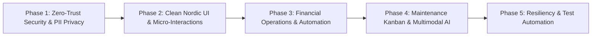

# Nestara AI — Comprehensive Phased System Improvement Roadmap

This document outlines the systematic, end-to-end upgrade roadmap for Nestara AI across all operational, architectural, security, and user-experience dimensions.

---

## Phase 1: Zero-Trust Security & Personal Data Privacy (DPDP & GDPR Compliance)

> **Objective:** Guarantee absolute isolation and defense-in-depth for sensitive resident data (phone numbers, financial records, declared salaries, lease contracts, and identity documents).

### 1.1 Tenant PII Masking with Audit Trail
* **Problem:** Anyone viewing landlord or admin screens can see unmasked resident phone numbers, emails, and emergency contacts.
* **Deliverable:**
  * Implement dynamic UI masking (e.g., `+91 98*** ***12`, `a****@gmail.com`) across the Tenant Directory, Applications Review, and Rent Ledger.
  * Provide a secure **"Reveal"** toggle that prompts for session confirmation and logs an internal access audit entry (`audit_logs: { action: 'reveal_pii', user_id, target_id, timestamp }`).

### 1.2 Brute-Force Rate Limiting & Account Lockout
* **Problem:** Credential stuffing attacks could attempt password guessing on `/api/auth/login`.
* **Deliverable:**
  * Add IP-based and email-based sliding-window rate limiters (maximum 5 failed attempts per 15-minute window).
  * Enforce progressive exponential delays (`429 Too Many Requests` with `Retry-After` header) before temporary 30-minute lockout.

### 1.3 Dual-Mode Database Connection Adapter (`src/server/db.ts`)
* **Problem:** Code currently assumes local Cloudflare D1 / SQLite; production needs seamless connection to Supabase / Neon PostgreSQL.
* **Deliverable:**
  * Implement an adaptive database driver in [`src/server/db.ts`](file:///d:/projects/nestaraai/Nestara-AI-main/src/server/db.ts):
    * If `DATABASE_URL` is set: connects to PostgreSQL/Supabase with native Row-Level Security (RLS) enforcement via [`src/server/supabase-schema.sql`](file:///d:/projects/nestaraai/Nestara-AI-main/src/server/supabase-schema.sql).
    * If local: defaults to zero-config local SQLite for rapid offline iteration.

### 1.4 Strict Content Security Policy (CSP) & Header Hardening
* **Deliverable:**
  * Add nonce-based script restrictions and strict connect-src directives to `secureHeaders` in [`src/server/index.ts`](file:///d:/projects/nestaraai/Nestara-AI-main/src/server/index.ts) to eliminate cross-site scripting (XSS) vectors.

---

## Phase 2: Clean Nordic Minimalist UI & Micro-Interactions

> **Objective:** Deliver a world-class Scandinavian aesthetic prioritizing high typography legibility, distraction-free data density, and instantaneous micro-interactions.

### 2.1 Nordic Toast Notification System
* **Problem:** Browser native `alert()` and `confirm()` interrupt user flow and break responsive mobile interfaces.
* **Deliverable:**
  * Build a lightweight, non-blocking toast component (`ToastProvider`, `useToast()`) with subtle micro-borders, clean status icons, and automatic 4-second dismissal.
  * Wire toasts across all mutation events (payment recorded, agreement downloaded, ticket dispatched).

### 2.2 Interactive Dashboard Visual Analytics
* **Problem:** The Landlord Dashboard relies heavily on numeric counters without visual occupancy or cashflow context.
* **Deliverable:**
  * **Occupancy Gauge Ring:** Visual circular progress ring indicating current occupied vs. vacant units across Bengaluru residences.
  * **Monthly Arrears & Collection Bar:** Clean split visualization showing collected rent vs. outstanding rent vs. overdue charges.
  * **Expiring Leases Carousel:** Visual card carousel highlighting leases expiring within 30 and 60 days with a one-click **"Renew 11-Month Term"** trigger.

### 2.3 Interactive Property Comparison Drawer in `/explore`
* **Problem:** Public users comparing listings currently have to open multiple tabs.
* **Deliverable:**
  * Add a floating comparison dock allowing prospective tenants to pin up to 3 properties.
  * Open a clean side-by-side comparison modal evaluating:
    * Monthly rent & security deposit.
    * Commute / Transit scores.
    * Square footage & bedroom/bathroom layouts.
    * AI Recommendation compatibility score.

### 2.4 Resident Self-Service Portal Quick-Tray
* **Deliverable:**
  * Add quick-action shortcuts in [`src/client/components/tenant/tenant-portal-page.tsx`](file:///d:/projects/nestaraai/Nestara-AI-main/src/client/components/tenant/tenant-portal-page.tsx):
    * "Pay Outstanding Rent" with pre-filled amount.
    * "Report Issue (AI Triage)" with camera snap preview.
    * "Download Active Agreement PDF".

---

## Phase 3: Financial Operations & Rental Automation

> **Objective:** Automate manual property management workflows, accounting synchronization, and lease lifecycles.

### 3.1 Automated Late Fee Penalty Engine
* **Problem:** Landlords currently have to manually track grace periods and overdue charges.
* **Deliverable:**
  * Backend cron / scheduled task that checks `rent_charges`:
    * If `due_date + grace_days < CURRENT_DATE` and `status != 'paid'`, update status to `'overdue'`.
    * Automatically append configured late fee penalty (from `settings.late_fee_amount`) to the ledger with a clear line-item description.

### 3.2 Audit-Grade CSV & Excel Data Export
* **Problem:** Property owners cannot export ledgers for tax filings, accountant reviews, or internal auditing.
* **Deliverable:**
  * Add `GET /api/rent-charges/export` and `GET /api/tenants/export` endpoints returning standard RFC 4180 CSV files.
  * Add **"Export CSV"** buttons in the Rent Ledger and Tenant Directory tables.

### 3.3 Applicant Debt-to-Income & Financial Risk Metric
* **Problem:** Landlords must manually compute whether an applicant earns enough to afford the unit.
* **Deliverable:**
  * In [`src/client/components/applications/applications-page.tsx`](file:///d:/projects/nestaraai/Nestara-AI-main/src/client/components/applications/applications-page.tsx), automatically calculate the **Rent-to-Income (RTI) Ratio**:
    * `< 30%`: Low Financial Risk (Emerald Badge).
    * `30% - 40%`: Moderate Risk (Amber Badge).
    * `> 40%`: High Risk (Rose Badge).

### 3.4 11-Month Lease Renewal & Deposit Release Flow
* **Deliverable:**
  * Add a **"Renew Lease"** action in [`src/client/components/leases/leases-page.tsx`](file:///d:/projects/nestaraai/Nestara-AI-main/src/client/components/leases/leases-page.tsx) that auto-populates a new 11-month contract starting from the current expiration date.
  * Add a **"Terminate & Refund Deposit"** modal tracking unit inspection deductions and deposit return receipts.

---

## Phase 4: Maintenance Operations & Multimodal AI Workflow

> **Objective:** Streamline vendor dispatches, issue categorization, and SLA tracking for tenant maintenance tickets.

### 4.1 Maintenance Kanban Board View
* **Problem:** List view alone makes it difficult to visualize tickets requiring immediate attention vs. those in progress.
* **Deliverable:**
  * Add a View Switcher (`Table View` | `Kanban Board`) in [`src/client/components/maintenance/maintenance-page.tsx`](file:///d:/projects/nestaraai/Nestara-AI-main/src/client/components/maintenance/maintenance-page.tsx).
  * Kanban columns:
    1. **Open / Needs Triage** (Red/Amber badges for urgent leaks/electrical).
    2. **Assigned to Vendor** (Plumber, Electrician, HVAC).
    3. **In Progress** (Technician on-site).
    4. **Completed & Verified**.
  * Quick vendor assignment dropdown directly on card hover.

### 4.2 Client-Side Image Pre-Processing & Compression
* **Problem:** High-resolution mobile photos (10MB–20MB) could slow down upload speeds or exceed worker body limits.
* **Deliverable:**
  * Add client-side canvas downscaling (max dimension 1280px, WebP quality 0.8) before base64 encoding in the tenant ticket submission modal, reducing upload size to `< 400KB` without visual fidelity loss.

---

## Phase 5: Resiliency, Automated Verification & Deployment Readiness

> **Objective:** Ensure rock-solid reliability, zero compilation errors, and complete unit/integration test coverage before remote production rollout.

### 5.1 Financial Edge-Case Vitest Suite
* **Deliverable:**
  * Add `src/server/__tests__/financial.test.ts`:
    * Mid-month lease pro-rated rent calculations.
    * Partial payments leaving exact remaining balances without rounding drift.
    * Overdue grace period calculations and late fee attachments.

### 5.2 Global Offline Fallback & Error Boundaries
* **Deliverable:**
  * Add a React Error Boundary with user-friendly recovery instructions if network drops.
  * LocalStorage caching for recent property search queries in public discovery.

---

## Implementation Matrix & Priority Roadmap

| Phase | Core Deliverables | Target Scope | Security / Architectural Value |
| :--- | :--- | :--- | :--- |
| **Phase 1** | PII Masking, Rate Limiting, Dual-Mode DB Adapter, CSP | Backend & Auth | Critical (DPDP/GDPR Data Privacy) |
| **Phase 2** | Nordic Toasts, Occupancy Gauge, Comparison Drawer | Frontend UI | High (User Engagement & Usability) |
| **Phase 3** | Automated Late Fees, CSV Export, RTI Ratio, Lease Renewal | Business Logic | High (Operational Automation) |
| **Phase 4** | Maintenance Kanban Pipeline, Client Image Compression | Operations & AI | Medium (Technician Workflow) |
| **Phase 5** | Financial Vitest Suite, Error Boundary, Offline Cache | QA & Testing | High (Zero-Regression Stability) |

